# 12.6 DrySister看妹子应用(第一版)——6.图标制作，混淆，签名打包，APK瘦身，应用发布

> 来源: https://www.runoob.com/w3cnote/android-tutorial-exercise-6-html.html

不要问我为什么标题这么长，怎么不写短点，我觉得你是

代码虽然写完了，但是发布的后续操作还是挺多的，如标题，
本节讲述的内容依次是：**应用图标的制作**，**混淆**，**签名打包APK**，**Apk瘦身**，
以及**发布应用**到酷安市场。内容较多就不唠叨了，直接开始~

## 1.图标制作

本来想着自己用Sketch做一枚的，摸索了10分钟不到就放弃了...
还是直接利用**AS自带的图标生成工具**一键生成算了，步骤如下：
**右键drawable文件夹** -> **new** -> **Image Asset**，选择自己喜欢
的图片做图标，比如我最喜欢的**过气女二蕾姆**，然后Next，接着
的弹窗无脑下一步就好：

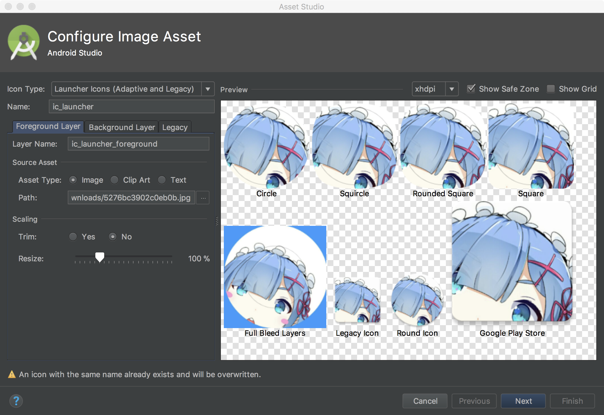

然后AS帮我们生成了一堆文件：

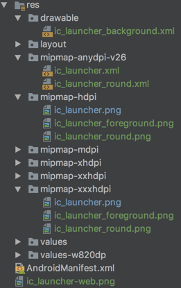

看到这里你可能会黑人问号？？？
这个**mipmap-anydpi-v26**文件夹是什么鬼？
还有为什么每个mipmap文件夹都多了**ic*launcher*foreground** 和 **ic*lanucher*round**

**原因是**：

> Android 8.0(API 26) 引入了自适应的启动器图标，它可以在不同的设备模型
> 中显示各种形状；其实就是把原本一层的图标分成了两个图层：**背景**与**前景**
> 然后不同的启动器有**Mask**(译作面具，不过感觉**遮罩层**更加贴切)然后，不同
> 的遮罩层能裁剪出不同的图形，比如示例中的圆形：

> 

> 除了这种玩法外还有**支持动画效果**，比如两层采用不一样的滑动速度：

> 

> 网上说Android 8.0可以长按桌面修改图标形状，试了下8.0的模拟器
> 并没有找到相关选项；有人说是Pixel Launcher，下了好几个版本发现
> 也没有，猜测应该是亲儿子Pixel系列自带的Launcher才能修改吧。
> 我用Nova Launcher和8.0的启动器对比也能看出差别：

> 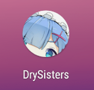

更多内容可见官网：[Adaptive Icons](https://developer.android.google.cn/guide/practices/ui_guidelines/icon_design_adaptive.html#creating_adaptive_icons_in_xml)
知道个所以然就行，不喜欢的话可以把文件都删掉，只保留一个 ic_launcher.png。

## 2.混淆

在应用发布前，对代码进行混淆处理，可以让我们的代码即使被
反编译，也让其难以阅读。AS自身集成Java的**ProGuard**作为压缩，
优化和混淆工具，混淆规则文件是：**proguard-rules.pro**，启用
混淆规则的话修改**build.gradle**中的**minifyEnabled**为**ture**即可开启混淆。
ProGuard除了能**混淆代码**外，还可以**减少应用体积**，对**字节码级别优化**
让我们的APP运行更快！另外，混淆完后会默认在**app/build/outputs/mapping/release**
下生成**mapping.txt混淆规则**文件，可以根据这个文件反推回混淆前的代码；
还有有些地方是要避免混淆的，不然APP运行的时候会出错。

限于篇幅就不在此讲解混淆的规则了，有兴趣的可以移步到：
[Android混淆从入门到精通](https://www.jianshu.com/p/7436a1a32891)
这里就直接用网上的通用模板了，如果是第三方的话，官方文档一般
都有混淆规则的，复制粘贴下即可，通用模板如下：

然后build.gradle里修改下，启用混淆以及打开压缩：

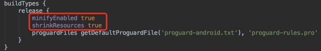

配置完成后，命令行执行一波**./gradlew build**即可生成apk。
我们来对比下混淆前后的结果：

|对比内容|混淆前|混淆后|
|:-|:-|:-|
|APK大小|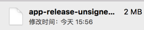|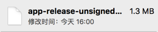|
|反编译代码|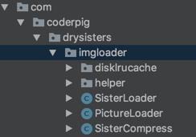|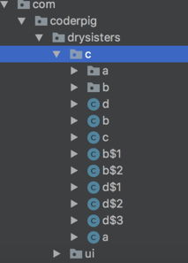

apk体积小了，反编译难度提高了，美滋滋!

## 3.签名打包

应用签名的重要性不言而喻，**应用的唯一标志**，**开发者的身份凭证**！
这样可以防止用户已安装的应用被恶意的第三方覆盖或替换掉，这种
逆向APP后进行二次打包的对于付费App和游戏App非常常见。

关于签名生成打包官方文档已经有详细叙述(可能需要梯子)：

[https://developer.android.com/studio/publish/app-signing.html#generate-key](https://developer.android.com/studio/publish/app-signing.html#generate-key)

**签名生成**：

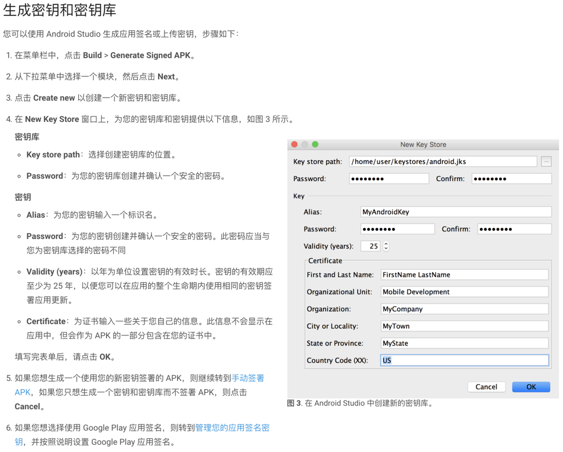

签名生成以后，就是使用签名打包了，打包方式有两种：
一种是**手动打包**，另一种是**通过gradle构建自动打包**

手动打包非常简单，也很low：依次点击：**Build** -> **Generate Signed APK**

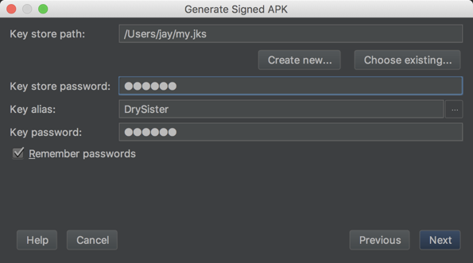

然后选择哪里存放生成的apk：

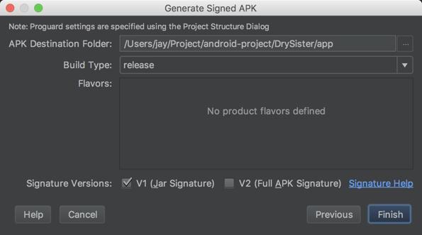

然后就可以看到生成的apk了：

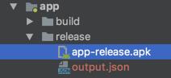

另一种是**gradle命令行构建**的，也很简单，图形化的可以看官方
文档，我这里直接贴代码，一般的话签名文件是不会丢到项目里
的，我这里因为是开源的，所以把**my.jks**也丢项目里了，然后
修改下**build.gradle**，依次是签名信息

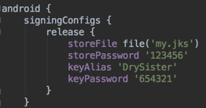

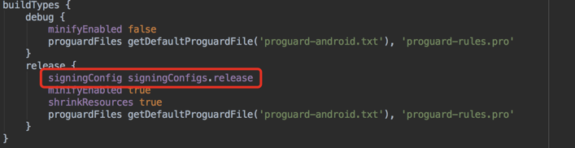

命令行走一波：**./gradlew clean build**编译运行，编译查看下述
目录app-release.apk是否生成成功：

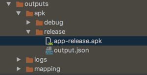

## 4.APK瘦身

经过混淆签名打包后的apk大小为1.4mb，但是作为一个没有什么图片，
没有采用第三方库的看图应用来说，实在是很差强人意，所以务必需
要对我们的APK瘦身一波。

Android Studio 自带的 **`APK Analyzer`**，可以对我们的APK做一个定量分析：

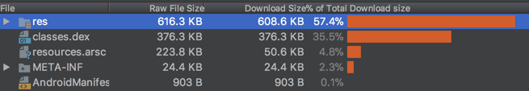

看得出是res占比最多，原因也是我们的图标，就不去把删图片和文件夹了，
只是用工具对图片进行压缩，这里安利个神器：**ImageOptim**

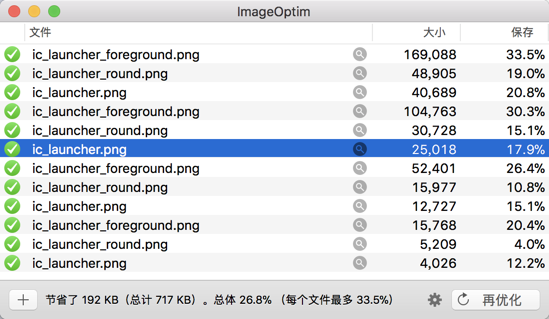

压缩完再看下apk体积变成了1.3mb，此时再分析下：

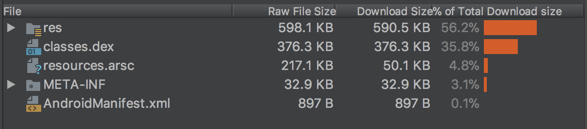

感觉没什么太大的变化，但是apk就是减少了0.1mb，图片
资源压缩是apk瘦身最基本的操作。关于其他的优化套路
后面版本再细谈，项目比较小，可优化的潜力很低...

## 5.应用发布

不要问我为什么是**酷安市场**，搞机的基佬基本都会混酷安的~
发布我们的应用，然后填写相关描述信息，传应用截图；
接着点**APK版本**上传我们的APK，这里会对apk包名做校验，
我之前写错一直没发现，后面改了才可以；

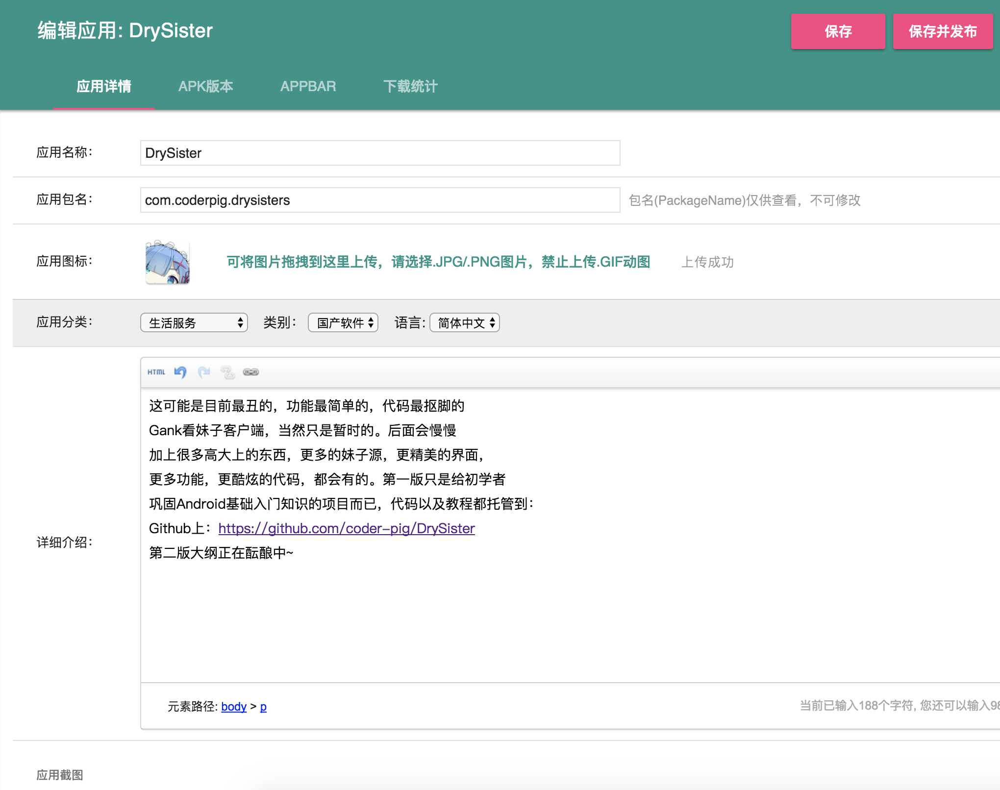

上传完要等检测，检测通过就可以提交了

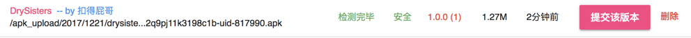

发布后就等审核啦！

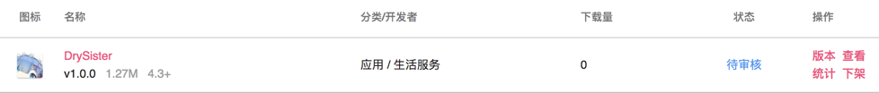

等明天管理员审核通过后就可以在酷安上找到我们的App了！

最后把我们develop分支上的代码合并到master上，每次正式版本
的才合并到master，同时打上Tag，打Tag是一种良好的习惯，
等版本线长了你就能体会到这个习惯给你带来的便利了：

## 6.小结

至此Android入门实战的项目：**DrySister**的第一版已经完结了，
回顾下一路走来，我们都学习了什么些什么吧？

- 1.**Git**的使用，远程仓库，分支管理的套路；

- 2.**HttpUrlConnection**请求网络；

- 3.**AsyncTask**，**Handler**的使用；

- 4.使用自带抠脚Json解析器解析**Json**；

- 5.图片二级缓存的流程；

- 6.使用**LruCache**和**DiskLruCache**搭建了简易图片缓存小框架；

- 7.原生数据库**SQLite**：数据库创建，表的增删改查，事务，分页；

- 8.如何编写**Log**工具类，崩溃日志采集类；

- 9.Apk图标的简易制作

- 10.Apk混淆

- 11.Apk签名生成，以及签名打包的两种方式

- 12.Apk分析工具：**APK Analyzer** 和图片压缩神器：**ImageOptim**

- 13.发布应用到应用市场。

如果你是一路踏踏实实走来的话，完成完该项目后说明入门
系列的东西掌握了，Android你也算**勉强入门**了，接下来如何
真正入门，并向进阶的迈进，路还远着呢！

最后感谢各位读者大佬一直以来的支持和陪伴，谢谢~

下一版的大纲正在规划中，敬请期待~

**代码下载**：

[https://github.com/coder-pig/DrySister/tree/develop](https://github.com/coder-pig/DrySister/tree/develop)
欢迎follow，star，觉得有什么想加进来的可以提下issues！

### 图片清单

1. 图1 -> images/1513929732-2075-c1rh9kum13ls1r3517onbap1vg2l.png （原图：https://www.runoob.com/wp-content/uploads/2017/12/1513929732-2075-c1rh9kum13ls1r3517onbap1vg2l.png）
2. 图2 -> images/1513929733-4065-a9p841mst2wexebw8mxshe74.png （原图：https://www.runoob.com/wp-content/uploads/2017/12/1513929733-4065-a9p841mst2wexebw8mxshe74.png）
3. 图3 -> images/1513929733-1791-1c1ri3ufc5qh17mf1nars9ocnm3a.png （原图：https://www.runoob.com/wp-content/uploads/2017/12/1513929733-1791-1c1ri3ufc5qh17mf1nars9ocnm3a.png）
4. 图4 -> images/1513929735-1771-11a4uu1jjfhts8amc5zof7w9.gif （原图：https://www.runoob.com/wp-content/uploads/2017/12/1513929735-1771-11a4uu1jjfhts8amc5zof7w9.gif）
5. 图5 -> images/1513929735-7017-lux8zvdif5n0h298pqsv0pyc.gif （原图：https://www.runoob.com/wp-content/uploads/2017/12/1513929735-7017-lux8zvdif5n0h298pqsv0pyc.gif）
6. 图6 -> images/1513929736-9880-unwujl73b0ljbhsdgoj30kto.png （原图：https://www.runoob.com/wp-content/uploads/2017/12/1513929736-9880-unwujl73b0ljbhsdgoj30kto.png）
7. 图7 -> images/1513929737-2143--1c1s01r2ok8fdmundg1dp5c0qal.png （原图：https://www.runoob.com/wp-content/uploads/2017/12/1513929737-2143--1c1s01r2ok8fdmundg1dp5c0qal.png）
8. 图8 -> images/1513929737-9469-c1s1csf0uleq931o691rtn13n6b2.png （原图：https://www.runoob.com/wp-content/uploads/2017/12/1513929737-9469-c1s1csf0uleq931o691rtn13n6b2.png）
9. 图9 -> images/1513929737-5863-c1s1fjgn1jlk4fs8ck1qka1knmbs.png （原图：https://www.runoob.com/wp-content/uploads/2017/12/1513929737-5863-c1s1fjgn1jlk4fs8ck1qka1knmbs.png）
10. 图10 -> images/1513929737-6044--1c1s1uhoqnc4l9kd4019jgu7vcl.png （原图：https://www.runoob.com/wp-content/uploads/2017/12/1513929737-6044--1c1s1uhoqnc4l9kd4019jgu7vcl.png）
11. 图11 -> images/1513929737-7831-c1s1vs0r14ra1a0eu80b1r12oid2.png （原图：https://www.runoob.com/wp-content/uploads/2017/12/1513929737-7831-c1s1vs0r14ra1a0eu80b1r12oid2.png）
12. 图12 -> images/1513929737-1104-c1s24l511ob21tdhv3s1rqdie3df.png （原图：https://www.runoob.com/wp-content/uploads/2017/12/1513929737-1104-c1s24l511ob21tdhv3s1rqdie3df.png）
13. 图13 -> images/1513929737-1587-s2nuj9197g1b4014me15vp12r0ds.png （原图：https://www.runoob.com/wp-content/uploads/2017/12/1513929737-1587-s2nuj9197g1b4014me15vp12r0ds.png）
14. 图14 -> images/1513929738-9522-s37odd1pu416ji1i5u19kf1olbe9.png （原图：https://www.runoob.com/wp-content/uploads/2017/12/1513929738-9522-s37odd1pu416ji1i5u19kf1olbe9.png）
15. 图15 -> images/1513929738-5799-1s396ec1nak10k11n5vvj71dnsem.png （原图：https://www.runoob.com/wp-content/uploads/2017/12/1513929738-5799-1s396ec1nak10k11n5vvj71dnsem.png）
16. 图16 -> images/1513929738-7867-1c1s3afnadg4rhh1jf9156slpef3.png （原图：https://www.runoob.com/wp-content/uploads/2017/12/1513929738-7867-1c1s3afnadg4rhh1jf9156slpef3.png）
17. 图17 -> images/1513929739-4046-1sdgh6u13l3ks810gr19o21e8kg0.png （原图：https://www.runoob.com/wp-content/uploads/2017/12/1513929739-4046-1sdgh6u13l3ks810gr19o21e8kg0.png）
18. 图18 -> images/1513929739-5014-1c1sdi97bc861s21leod7912drgd.png （原图：https://www.runoob.com/wp-content/uploads/2017/12/1513929739-5014-1c1sdi97bc861s21leod7912drgd.png）
19. 图19 -> images/1513929738-3211-1c1sdm6dli7f1nsunfkl2s1hueh1.png （原图：https://www.runoob.com/wp-content/uploads/2017/12/1513929738-3211-1c1sdm6dli7f1nsunfkl2s1hueh1.png）
20. 图20 -> images/1513929739-4641-c1sfjls911vubgs17bh1nta26ahe.png （原图：https://www.runoob.com/wp-content/uploads/2017/12/1513929739-4641-c1sfjls911vubgs17bh1nta26ahe.png）
21. 图21 -> images/1513929739-1693-1c1shk5nc5avaas1sr8m3t1f8qhr.png （原图：https://www.runoob.com/wp-content/uploads/2017/12/1513929739-1693-1c1shk5nc5avaas1sr8m3t1f8qhr.png）
22. 图22 -> images/1513929740-4689-c1si1mgu1nm915t1t40llq1actj5.png （原图：https://www.runoob.com/wp-content/uploads/2017/12/1513929740-4689-c1si1mgu1nm915t1t40llq1actj5.png）
23. 图23 -> images/1513929740-9774-5gsbz16gv4e6c9bwje6egfd6.png （原图：https://www.runoob.com/wp-content/uploads/2017/12/1513929740-9774-5gsbz16gv4e6c9bwje6egfd6.png）
24. 图24 -> images/1513929740-5076--1c1sjv2gnu041nn1a96mlcb3hju.png （原图：https://www.runoob.com/wp-content/uploads/2017/12/1513929740-5076--1c1sjv2gnu041nn1a96mlcb3hju.png）
25. 图25 -> images/1513929740-7682-1sp9869v4b1vt2132d17b91hh4kb.png （原图：https://www.runoob.com/wp-content/uploads/2017/12/1513929740-7682-1sp9869v4b1vt2132d17b91hh4kb.png）
26. 图26 -> images/1513929741-2356-494fa1874049dd6e582cef06e5.0.jpg （原图：https://www.runoob.com/wp-content/uploads/2017/12/1513929741-2356-494fa1874049dd6e582cef06e5.0.jpg）
