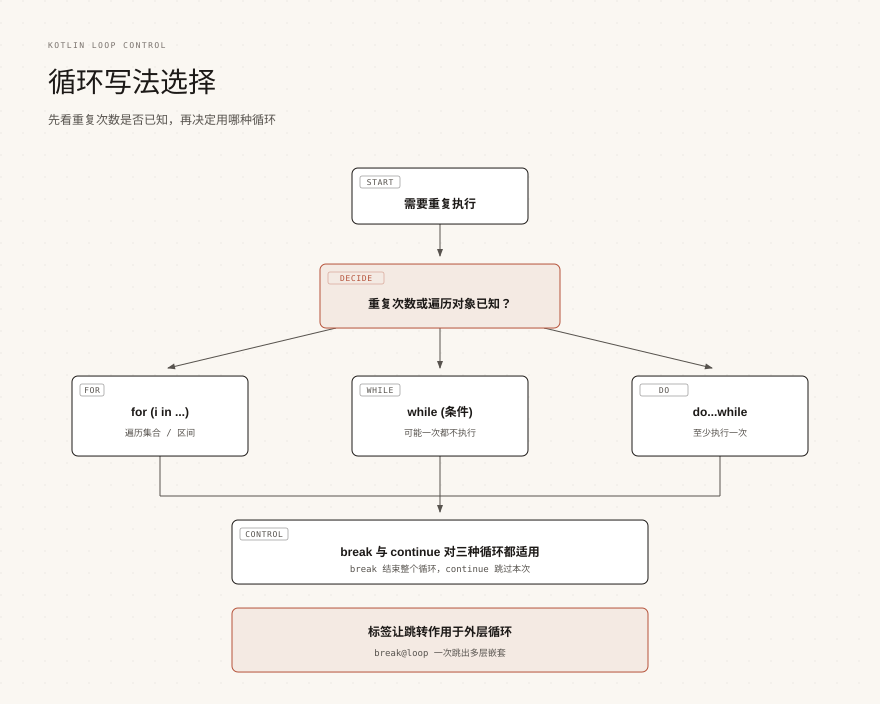
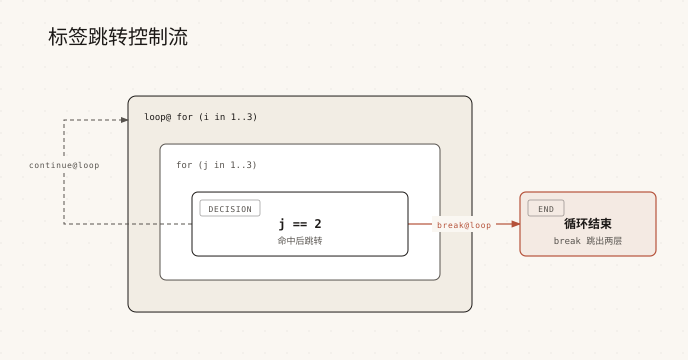

# Kotlin 循环控制

> 来源: https://www.runoob.com/kotlin/kotlin-loop-control.html

循环让同一段代码重复执行，是控制程序流程最基本的工具之一。

Kotlin 的循环语法和 Java 很像，但没有传统的三段式 `for (int i = 0; i < n; i++)`，取而代之的是直接遍历集合与区间。

本页介绍 for、while、do...while 三种循环，以及 break、continue 的标签跳转，最后是 Kotlin 2.2 起稳定的非局部 break 与 continue。

---

## for 循环

for 循环用于遍历任何提供了迭代器（iterator）的对象，集合、数组、区间都可以。

语法是 `for (元素 in 可迭代对象) { ... }`，元素不需要声明类型，编译器会自动推断。

运行结果如下。

遍历数组的方式完全一样，因为数组同样提供了迭代器。

Kotlin 的 for 只负责"取出元素"，不负责维护计数器，因此不会有忘记写 `i++` 导致死循环的问题。

---

## 区间与步长

区间（range）本身就是一个可遍历对象，用 `..`、`until`、`downTo`、`step` 构造。

它们的边界规则各不相同，混用是初学者最容易出错的地方。

| 写法 | 含义 | 遍历结果

| `1..5` | 闭区间，包含左右两端 | 1 2 3 4 5

| `1 until 5` | 左闭右开，不包含右端 | 1 2 3 4

| `5 downTo 1` | 从大到小递减 | 5 4 3 2 1

| `1..10 step 2` | 指定步长，只取奇数 | 1 3 5 7 9

| `1..<5` | 半开区间，等价于 until，Kotlin 1.9 起稳定 | 1 2 3 4

下面的例子把这几种写法放在一起对比。

区间不只用于循环，也可以用 `in` 判断某个值是否落在区间内，例如 `if (age in 18..60)`。

> **提示：**直接遍历区间会被编译器优化成普通计数循环，不会为每个元素创建对象。但如果先写 `(1..1000).toList()` 再遍历，就会真的创建一个包含 1000 个元素的列表。

---

## 用下标遍历：indices 与 withIndex

需要同时拿到下标和元素值时，可以用 `indices` 或库函数 `withIndex()`。

`indices` 是下标区间，`withIndex()` 返回一组带下标的元素，可以配合解构声明使用。

Map 也是可迭代对象，遍历时可以直接解构出键和值。

---

## while 循环

while 先判断条件，条件为真才执行循环体，可能一次都不执行。

循环次数不确定、依赖运行时状态时，while 比 for 更合适。

如果条件一开始就是 false，循环体一次也不会执行。

---

## do...while 循环

do...while 先执行一次循环体，再判断条件，因此循环体至少执行一次。

适合"先做一次、再决定要不要继续"的场景，比如读取输入、重试操作。

> **注意：**do...while 的 `while` 后面要写分号，而普通 while 和 for 不需要。这是 Kotlin 中少数必须写分号的位置之一。

---

## break 与 continue

break 立即结束最内层的循环，continue 跳过本次迭代、直接进入下一次。

两者都只作用于"最直接包围它们的循环"，除非配合标签使用。

| 跳转表达式 | 作用 | 典型场景

| `break` | 终止最近的循环 | 找到目标后提前退出，避免无谓遍历

| `continue` | 跳过本次迭代，进入下一次 | 过滤掉不满足条件的元素

| `return` | 从最近的函数返回 | 结束函数执行并带回结果

---

## 标签与标签跳转

标签是标识符后面加 `@`，写在循环或 lambda 前面，用来给 break、continue、return 指定目标。

没有标签时，break 只能结束最内层循环；有了标签才能一次跳出多层嵌套。

标签也可以标在 lambda 上，此时 `return@标签` 表示从这个 lambda 返回，而不是从外层函数返回。

> **提示：**标签名和变量名可以重名，但为了可读性，建议给循环和 lambda 起有含义的标签名，例如 `outer@`、`rows@`。

---

## 非局部 break 与 continue（2.2 起稳定）

Kotlin 2.2 起，内联 lambda 中的 break 和 continue 可以直接作用到外层的循环，这种写法叫非局部跳转。

它解决的是"在 lambda 内部想跳过或结束外层循环"的问题，此前只能用 `return@标签` 或者额外的标志变量绕开。

这个特性在 Kotlin 2.1 中作为预览提供，需要编译器选项 `-Xnon-local-break-continue` 才能使用；从 2.2 起默认可用（KT-1436）。

break 同样可以这样用，效果是直接结束外层的整个循环。

> **注意：**非局部 break/continue 只对传给内联函数（inline function）的 lambda 有效，例如 `run`、`let`、`forEach` 的 lambda。如果 lambda 被保存成变量再传给普通函数，仍然不允许这样跳转，因为编译器无法保证它一定在原地执行。

---

## return 与标签返回

return 默认从最近的函数返回，但在 lambda 中要区分两种情况：返回外层函数，还是只结束这个 lambda。

`return@标签` 只从标签对应的 lambda 返回，效果相当于 lambda 里的 continue。

标签名可以省略，此时编译器用接收 lambda 的函数名作为隐式标签，所以 `return@forEach` 里的 `forEach` 就是隐式标签。

> **注意：**`forEach` 是内联函数，所以在它的 lambda 里直接写 `return` 会从外层函数返回，而不是只结束这一次遍历。这种非局部返回的规则会在《[Kotlin 内联函数与 reified](kotlin-inline-function.html)》一篇详细展开；日常写法中，只跳过当前元素请用 `return@forEach`。

---

## 常见问题

下面整理几个初学者经常遇到的疑问。

| 问题 | 说明

| for 循环里的区间会创建对象吗 | 直接遍历 `1..10` 会优化成计数循环，不创建额外对象；先转成 List 再遍历则会创建集合

| 在 forEach 里写 continue 报错 | forEach 的 lambda 不是循环，改用 `return@forEach`，或者换成 for 循环

| do...while 后面为什么有分号 | Kotlin 语法规定 `while (条件)` 之后要写分号，这是分号不能省略的少数位置

| 标签写在哪里 | 标签紧跟在被标记对象前面，例如 `loop@ for (...)`、`name@ { ... }`

| 非局部 break 在旧版本报错 | 该特性 2.1 为预览、2.2 起稳定；旧版本请改用标签返回或标志变量

### 图片清单

1. 图1 -> images/09-loop-choice.svg （原图：https://www.runoob.com/wp-content/uploads/2017/05/09-loop-choice.svg）
2. 图2 -> images/09-labeled-jump.svg （原图：https://www.runoob.com/wp-content/uploads/2026/09/09-labeled-jump.svg）
