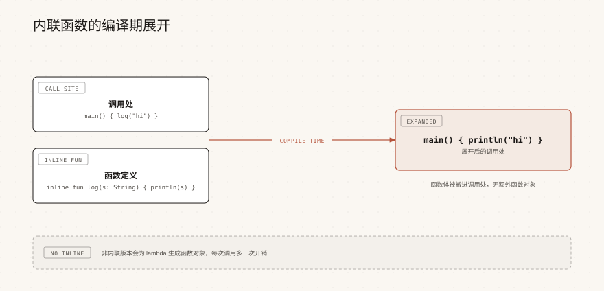

# Kotlin 内联函数与 reified

> 来源: https://www.runoob.com/kotlin/kotlin-inline-function.html

Lambda 用起来很轻巧，但在 JVM 上每个 Lambda 都会被编译成一个函数对象，高频调用时这些对象会带来实实在在的开销。

`inline` 让编译器把函数体和 Lambda 体直接复制到调用处，从而消除函数对象和调用开销，也是 `reified` 类型参数能够存在的前提。

本章节说明为什么需要内联、noinline 与 crossinline 的区别、非局部返回的规则，以及什么时候不该用 inline。

---

## 为什么需要内联

没有 inline 时，一个接收 Lambda 的函数在编译后是这样工作的：调用方先创建一个函数对象，再把它传给函数，函数内部通过 `invoke()` 调用它。

如果这个函数在循环里被调用成千上万次，就会产生成千上万个临时对象。

两者的输出完全一样，区别只在编译结果。

可以用 `javap -p -c InlineBasicKt` 查看字节码：普通调用会生成一个函数对象并调用它的 `invoke`，内联调用则只剩下两条 `println` 指令。

| 对比项 | 普通高阶函数 | 内联函数

| Lambda 参数 | 编译成函数对象 | 直接展开到调用处，不创建对象

| 调用方式 | 通过 invoke 调用 | 代码内联，无额外调用

| 生成代码体积 | 较小，只有一份函数体 | 每个调用处都复制一份，体积变大

| 非局部返回 | 不支持 | 支持

---

## inline 关键字

在 `fun` 前面加 `inline` 就是内联函数，它的函数体以及所有函数类型参数都会在调用处展开。

普通代码参数（非函数类型）只是被复制过去，函数类型参数则连 Lambda 体一起复制。

内联函数的调用语法和普通函数完全相同，调用方不需要知道它是内联的。

标准库里的 `forEach`、`map`、`filter`、`let`、`run`、`apply`、`also`、`repeat` 都是内联函数，这也是它们能支持非局部返回的原因。

---

## 非局部返回

内联函数最直观的好处是：Lambda 里的 `return` 可以从外层函数直接返回，这叫非局部返回（non-local return）。

因为 Lambda 的代码已经被复制进调用方函数，这个 return 在编译后就位于外层函数体内。

把上面的 `inline` 去掉，代码就无法编译，因为普通函数的 Lambda 是一个独立对象，不能跳回调用方。

> **注意：**非局部返回只在 Lambda 直接作为参数传给内联函数时有效。如果 Lambda 先被存进变量、或者被传给一个普通函数，它就失去了内联上下文，不能再跳出外层函数。

---

## noinline

内联函数的函数类型参数默认全部内联，如果某个 Lambda 需要被保存到变量、作为参数转交给别的函数，就要用 `noinline` 关掉它的内联。

被 noinline 修饰的参数仍然会创建函数对象，因此只在你确实需要把它当值使用时才加。

如果去掉 noinline，编译器会报错，提示不能把内联参数保存下来，因为它已经不再是一个真实存在的对象。

---

## crossinline

还有一种情况：Lambda 仍然内联，但它被放进了另一个执行上下文，比如另一个 Lambda 或对象表达式里。

此时需要用 `crossinline`，它保留内联，同时禁止在这个 Lambda 里使用非局部返回。

不加 crossinline 时，上面把 `block` 放进 `Runnable` 的写法会报错，提示需要给参数加上 crossinline 修饰符。

标准库中的 `sortedBy` 就使用了 crossinline，因为它要把选择器传给 `compareBy`，属于在另一个上下文中使用。

| 修饰符 | 是否内联 | 能否非局部返回 | 典型场景

| 默认 | 是 | 可以 | Lambda 只在函数体内直接调用

| `noinline` | 否 | 不可以 | Lambda 要保存成变量或传给其他函数

| `crossinline` | 是 | 不可以 | Lambda 在另一个 Lambda 或对象里被调用

---

## reified 类型参数

JVM 的泛型会在编译后被擦除，运行时拿不到具体的类型参数，所以普通泛型函数里不能写 `is T` 或 `T::class`。

`reified` 把类型实参保留到调用处，编译器会把 T 替换成真实类型，从而绕开类型擦除。

它只能用在 inline 函数上，因为只有内联才能在每个调用点看到具体类型。

reified 最实用的场景是配合集合做类型过滤，标准库的 `filterIsInstance` 就是这样实现的。

> **注意：**reified 只能做类型判断和获取类型信息，不能直接写 `T()` 来创建实例，因为编译器并不知道 T 的构造函数长什么样。需要创建实例时，可以额外接收一个构造器引用参数。

---

## @PublishedApi

public 的内联函数会被复制到调用方模块，如果它内部访问了 `internal` 或 `private` 的声明，那些声明的字节码也必须在调用方可见。

`@PublishedApi` 用来标记这类声明，让编译器为它生成公开的字节码，同时在 Kotlin 层面仍然保持 internal 的可见性。

去掉 `@PublishedApi` 后，编译器会报错，提示 public 内联函数不能访问非 public 的 API。

---

## 什么时候不该用 inline

inline 不是"更快的开关"，它本质上是用代码体积换运行开销。

函数体越大、调用点越多，复制带来的体积膨胀就越明显，甚至可能因为指令缓存失效而变慢。

| 适合使用 inline | 不适合使用 inline

| 函数体很小，接收 Lambda 参数 | 函数体很长，逻辑复杂

| 需要 reified 类型参数 | 没有函数类型参数，也没有 reified 需求

| 需要非局部返回来简化控制流 | Lambda 需要被保存或转交（应改用 noinline）

| 调用频率高、希望避免 Lambda 对象分配 | 调用点非常多而函数体又大，体积急剧增长

一个简单的判断标准：只有当函数"接收 Lambda 参数"或者"需要 reified"时，才考虑加 inline，其余情况通常得不偿失。

---

## 常见问题

下面整理几个关于内联函数的常见疑问。

| 问题 | 说明

| inline 会让程序一定更快吗 | 不一定，它省掉 Lambda 对象与调用开销，但会增大代码体积，函数体大时可能变慢

| 为什么我的 return 编译报错 | 非局部返回要求 Lambda 直接传给内联函数；如果 Lambda 被存成变量就不再成立

| noinline 和 crossinline 有什么区别 | noinline 不内联、可当值用；crossinline 仍内联，但禁止非局部返回

| reified 能用在普通函数上吗 | 不能，reified 只允许出现在 inline 函数的类型参数上

| 为什么内联函数访问 internal 会报错 | 内联函数会被复制到其他模块，需要给被访问的声明加 `@PublishedApi`

### 图片清单

1. 图1 -> images/12-inline-expand.svg （原图：https://www.runoob.com/wp-content/uploads/2026/09/12-inline-expand.svg）
