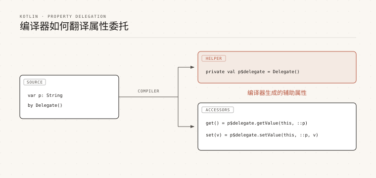

# kotlin 委托

> 来源: https://www.runoob.com/kotlin/kotlin-delegated.html

委托是一种基础的设计模式：一个对象把请求转交给另一个对象来处理。

Kotlin 用 `by` 关键字直接支持委托，编译器会自动生成转发代码，比手写委托类简洁得多。

Kotlin 的委托分为两类：类委托和属性委托，本章节会逐一讲解，并说明编译器的翻译规则。

---

## 类委托

类委托的写法是在类头后面加 `: 接口 by 委托对象`，编译器会为接口中的每个方法生成转发实现。

输出结果为：

编译器会把 `b` 保存到 `Derived` 的实例里，并生成 `Base` 接口的全部方法，把它们转发给 `b`。

你可以在 `Derived` 中重写某个方法，让它覆盖委托对象的行为。

输出结果为：

---

## 属性委托

属性委托把属性的读取和写入交给另一个对象来完成，语法是 `val 或 var 属性名: 类型 by 委托表达式`。

属性委托不需要实现任何接口，但必须提供 `getValue()`，`var` 属性还额外需要 `setValue()`。

输出结果为：

### getValue 与 setValue 的签名要求

委托对象的这两个方法必须带 `operator` 关键字，参数和返回值都有明确约束。

| 方法 | 适用属性 | 参数 | 返回值要求

| `getValue()` | `val` 和 `var` | `thisRef` 为属性所有者类型或其超类型；`property` 为 `KProperty<*>` 或其超类型 | 属性类型或其子类型

| `setValue()` | 仅 `var` | 在 `getValue` 的参数后追加 `value`，类型为属性类型或其超类型 | 无（返回 Unit）

对于扩展属性，`thisRef` 指的是被扩展的类型。

---

## 标准委托 lazy

Kotlin 标准库内置了常用的委托工厂方法，`lazy()` 是最常用的一个。

它接收一个 lambda，返回一个 `Lazy<T>` 实例，第一次读取属性时才执行 lambda 并记住结果，之后直接返回缓存值。

输出结果为：

局部变量也可以用 `lazy` 委托，这个特性从 Kotlin 1.1 起可用。

### LazyThreadSafetyMode

`lazy()` 的第二个可选参数控制多线程下的初始化行为，默认值是 `SYNCHRONIZED`。

| 模式 | 行为 | 适用场景

| `SYNCHRONIZED` | 加锁保证只有一个线程执行初始化，其他线程阻塞等待 | 默认值，多线程环境下的通用选择

| `PUBLICATION` | 允许并发初始化，最先返回的结果胜出 | 初始化开销大且允许重复执行

| `NONE` | 不做任何同步，不保证只初始化一次 | 只在单线程中使用，性能最高

输出结果为：

> **注意：**默认的 `SYNCHRONIZED` 模式会让所有线程在首次访问时同步等待，如果初始化逻辑可能抛异常，再次访问时会重新尝试初始化，因此异常不会导致属性永久不可用。

---

## 可观察属性 observable 与 vetoable

`Delegates.observable()` 在每次赋值之后回调，适合做观察者模式。

它接收初始值和回调两个参数，回调有三个参数：属性对象、旧值和新值。

输出结果为：

`Delegates.vetoable()` 的回调在赋值之前执行，返回 `true` 才允许写入，返回 `false` 则拒绝这次赋值。

输出结果为：

---

## 把属性存储在映射中

把属性委托给一个 Map 实例是很常见的用法，解析 JSON 或处理动态数据时尤其方便。

委托给 Map 时，属性的名字会作为 key 去映射里取值。

输出结果为：

如果要委托的是 `var` 属性，Map 必须换成 `MutableMap`，赋值会直接写回映射。

输出结果为：

---

## Delegates.notNull

有些属性的值无法在初始化阶段确定，`Delegates.notNull()` 就是为这种场景准备的。

它允许属性先声明后赋值，但在赋值之前读取会抛出异常。

输出结果为：

如果跳过赋值直接读取，程序会抛出 `IllegalStateException`。

输出结果为（省略堆栈信息）：

> **注意：**`Delegates.notNull()` 只适用于非空类型。它的语义是「延迟赋值但保证非空」，而 `lateinit` 也能达到类似效果，区别在于 `lateinit` 只能用于类属性，不能用于基本类型。

---

## 局部委托属性

委托不只可以用于类属性，局部变量也可以委托，这个特性从 Kotlin 1.1 起可用。

把局部变量委托给 `lazy` 就能实现「用到时才计算」的懒加载。

输出结果为：

如果某个分支根本不访问这个变量，它的初始化逻辑就完全不会执行，这正是懒加载的价值。

---

## provideDelegate

默认情况下，委托对象是在属性声明处直接创建的。

如果 `by` 右边的对象定义了 `provideDelegate`，编译器会改为调用它来创建真正的委托实例，这个特性从 Kotlin 1.1 起可用。

它最大的价值在于：可以在属性绑定阶段就做校验，而不必等到 getter 或 setter 执行时。

输出结果为：

如果把属性名写错，错误会在创建对象时立刻暴露，而不是拖到读取属性时才出现。

输出结果为（省略堆栈信息）：

`provideDelegate` 的参数与 `getValue` 相同，只影响辅助属性的创建，不会改变 getter 和 setter 生成的代码。

---

## 翻译规则

每个委托属性背后，编译器都会生成一个隐藏的辅助属性，并把访问器委托给它。

以属性 `prop` 为例，生成的辅助属性叫 `prop$delegate`。

如果使用了 `provideDelegate`，辅助属性的初始化会变成调用 `provideDelegate`。

这里的 `this::prop` 是一个 `KProperty` 反射对象，它携带了属性的名字等元信息，所以委托对象才能知道自己在为哪个属性服务。

---

## 常见问题

下面整理委托使用中最常见的几个问题。

| 问题 | 原因 | 解决办法

| 委托对象缺少 `operator` 关键字 | `getValue` / `setValue` 必须声明为运算符函数 | 在方法前加上 `operator`

| `val` 属性委托后仍想赋值 | 委托对象没有 `setValue`，只读属性也不允许赋值 | 把属性改为 `var` 并补上 `setValue`

| 委托给 Map 时读取报错 | 映射里缺少对应的键 | 确保键名与属性名一致，或改用带默认值的映射

| `Delegates.notNull` 读取时抛异常 | 属性在赋值之前被访问 | 先赋值再读取，或改用可空类型

| 多线程下 lazy 初始化重复执行 | 使用了 `NONE` 模式 | 改回默认的 `SYNCHRONIZED` 模式

| 想看委托到底生成了什么代码 | 辅助属性是编译器生成的，源码里看不到 | 反编译字节码，观察 `prop$delegate` 字段

### 图片清单

1. 图1 -> images/24-delegation-translation.svg （原图：https://www.runoob.com/wp-content/uploads/2026/09/24-delegation-translation.svg）
