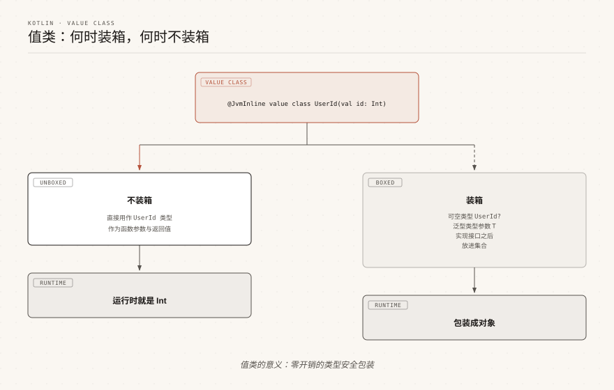

# Kotlin 值类

> 来源: https://www.runoob.com/kotlin/kotlin-value-class.html

值类（value class）让开发者给基本类型套上一层有语义的类型外壳，同时几乎不付出运行时开销。

它解决的是"用 String 表示邮箱、用 Int 表示用户 ID 容易传错参数"这类问题，又不会像普通包装类那样每次使用都分配对象。

---

## 什么是值类

值类的核心思想是：源码层面它是一个独立的类型，编译后却尽量退化为它包裹的那个底层值。

先看一个没有值类时容易犯的错误。

运行结果：

如果把账号和密码分别包装成两个不同的值类，编译器就能在编译期拦住这类错误。

---

## 从 inline class 到 value class

值类的概念最早以 `inline class` 的名字出现，Kotlin 1.3 起可以使用。

Kotlin 1.5 起官方统一改称 `value class`，并要求必须加上 `@JvmInline` 注解。

| 版本 | 写法 | 说明

| Kotlin 1.3 起 | `inline class UserId(val value: Int)` | 使用 `inline` 修饰符，不需要注解

| Kotlin 1.5 起 | `@JvmInline value class UserId(val value: Int)` | 官方推荐写法，旧写法已弃用

> **注意：**Kotlin 2.2 下再写 `inline class` 会得到弃用警告，请一律使用 `@JvmInline value class`。

`@JvmInline` 来自默认导入的 `kotlin.jvm` 包，因此不需要额外 import。

---

## 定义并使用值类

值类用 `@JvmInline` 和 `value` 两个关键字声明。

主构造器必须有且仅有一个用 `val` 修饰的参数，这个参数称为底层属性（underlying property），是值类真正存储的数据。

运行结果：

注意最后一行输出：值类自动生成的 `toString()` 格式是"类名(属性名=值)"，和数据类一致。

---

## 在 init 块中校验取值

值类可以带 `init` 初始化块，Kotlin 1.4.30 起支持。

这适合在构造阶段就拦掉非法的底层值，让"类型正确"进一步变成"取值也正确"。

运行结果：

如果希望强制走校验逻辑，可以把主构造器设为私有，再通过伴生对象提供工厂函数。

运行结果：

---

## 与数据类的区别

值类和数据类都用于包装数据，但设计目标完全不同。

数据类关注"这一组数据是什么"，值类关注"这一个值代表什么含义"。

| 对比项 | 值类 value class | 数据类 data class

| 属性数量 | 主构造器有且仅有 1 个 val 属性 | 主构造器至少 1 个属性，可多个

| 运行时表示 | 尽量退化为底层值，通常不分配对象 | 始终是一个普通对象

| 自动生成成员 | equals / hashCode / toString | equals / hashCode / toString / copy / componentN

| 解构声明 | 不支持 | 支持，按属性顺序解构

| 继承 | 不能继承类，可以实现接口 | 不能是 open / abstract / sealed，可以实现接口

| 典型用途 | 类型安全的 ID、单位、金额、百分比 | DTO、函数返回值、多字段聚合

> **注意：**值类不能加 `data` 修饰符，也不能是 `open`、`abstract` 或 `sealed`。

---

## 值类的限制

值类的"零开销"来自编译器能直接使用底层值，因此语言层面必须限制它的形态。

| 限制 | 说明

| 主构造器只有一个 val 参数 | 多一个参数就无法确定底层值

| 底层属性只能是 val | 值类按值传递，不允许改底层数据

| 不能有带 backing field 的属性 | 只能写计算属性（自定义 getter，不存数据）

| 不能是 inner 类 | 内部类需要持有外部类引用，与值语义冲突

| 不能继承其他类 | 但可以实现接口

| 必须是 final | 不能 open / abstract / sealed

| JVM 平台必须加 @JvmInline | 其他后端（如 Kotlin/Native）不需要

可以带计算属性，只要它不保存额外状态。

运行结果：

---

## 装箱与不装箱的时机

值类"没有额外开销"的前提，是编译器能用底层类型直接表示它。

一旦值类需要被当成普通对象引用使用，编译器就会自动装箱，此时它和一个普通包装类没有区别。

| 使用方式 | 是否装箱 | 原因

| 直接作为具体类型的变量、参数、返回值 | 不装箱 | 编译后直接使用底层类型

| 赋给 Any 或它实现的接口 | 装箱 | 需要对象头和虚方法表

| 可空类型 UserId? | 装箱 | 底层 Int 无法表示 null

| 作为泛型实参，如 List<UserId> | 装箱 | 泛型类型参数只接受引用类型

| 存入 Array<UserId> | 装箱 | 数组元素本身就是引用

| 使用 === 做引用比较 | 编译报错 | 值类没有稳定的引用身份

下面用接口演示装箱：同一个值类，作为具体类型传递时不装箱，作为接口类型传递时装箱。

运行结果：

> **建议：**如果值类定义了大量使用，尽量让函数签名直接使用值类本身，而不是 `Any`、接口或泛型容器，这样才能真正省下装箱开销。

---

## 常见问题

值类支持解构声明吗？

不支持。值类只生成 `equals`、`hashCode` 和 `toString`，不会生成 `componentN`，因此不能写成 `val (v) = UserId(1)`。

值类可以作为 Map 的 key 吗？

可以。值类重写了 `equals` 和 `hashCode`，语义与数据类一致，底层相同的两个实例在 Map 中视为同一个 key。

值类能和数据类互相替代吗？

不能。需要多个字段、需要 `copy` 或解构时用数据类；只需要包装单个值并获得类型安全时用值类。

值类一定不分配对象吗？

不一定。只要出现可空、泛型、接口或 `Any` 这几类用法，编译器就会装箱，具体是否装箱可以用 `javap` 反编译字节码确认。

### 图片清单

1. 图1 -> images/25-value-class-boxing.svg （原图：https://www.runoob.com/wp-content/uploads/2026/09/25-value-class-boxing.svg）
