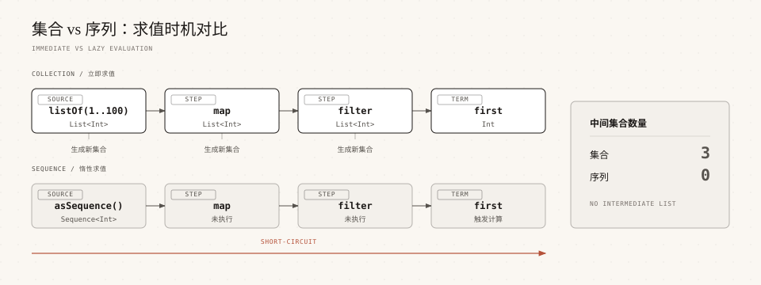

# Kotlin 序列

> 来源: https://www.runoob.com/kotlin/kotlin-sequence.html

序列（Sequence）是一种惰性求值的集合视图，它把多个操作合并成一次遍历，避免生成大量中间集合。

集合的 filter、map 每调用一次就会生成一个新列表，数据量大时内存和时间都会被浪费；序列则让元素逐个流过整条操作链。

本章节讲清楚序列和集合的区别、如何创建序列，以及在什么场景下值得改用序列。

---

## 什么是序列

序列由接口 `Sequence<T>` 表示，它只承诺一件事：可以逐个产出元素。

与 List、Set 不同，序列本身不存储元素，它保存的是「如何计算下一个元素」的规则。

> **提示：**序列不是一种新的数据结构，它更像是给集合套上的一层「处理管道」，管道里的加工步骤要到真正取结果时才执行。

---

## 序列与集合的区别

集合操作是立即求值的，每个函数都会完整执行并返回一个新集合。

序列操作是惰性求值的，中间操作只记录步骤，末端操作才触发计算。

| 对比项 | 集合（Iterable） | 序列（Sequence）

| 求值时机 | 立即求值，每个操作都执行 | 惰性求值，末端操作才执行

| 中间结果 | 每一步都生成一个新集合 | 不生成中间集合，元素逐个流过

| 遍历次数 | 每个操作各遍历一次 | 所有操作合并成一次遍历

| 能否无限长 | 不能，必须先把元素装进内存 | 可以，配合 take 截取有限部分

| 小数据量性能 | 更快，没有额外包装开销 | 略慢，多了迭代器和 lambda 开销

| 适用场景 | 元素不多，或需要多次遍历 | 元素很多，或有提前终止的操作

下面的例子把同一个链式操作分别作用在集合和序列上，用计数器记录 lambda 实际执行了多少次。

结果相同，但集合执行了 15 次 lambda，序列只执行了 9 次，因为序列在拿到 36 之后就不再处理后面的元素了。

---

## 创建序列

创建序列有四种常用方式，分别适合不同的数据来源。

| 方式 | 用途 | 示例

| sequenceOf | 用已知的若干元素创建序列 | `sequenceOf("runoob", "RUNOOB")`

| asSequence | 把已有的集合、数组转成序列 | `listOf(1, 2).asSequence()`

| generateSequence | 由种子和「下一个值」的规则生成序列，可以无限长 | `generateSequence(1) { it * 2 }`

| sequence { } | 用 yield 手动产出元素，适合复杂逻辑 | `sequence { yield(1) }`

> **注意：**`sequence { }` 的代码块是挂起函数，里面只能调用 `yield`、`yieldAll` 这类 SequenceScope 提供的挂起函数，不能直接调用别的 suspend 函数。这个构建器从 Kotlin 1.3 起提供。

用 `Iterator.asSequence()` 包装得到的序列只能遍历一次，第二次遍历会抛异常；需要防止误用时可以调用 `constrainOnce()`（Kotlin 1.3 起）把它显式标记为一次性。

---

## 中间操作与末端操作

序列上的函数分两类：中间操作返回新的序列，末端操作返回一个具体结果并触发计算。

中间操作只是把步骤记录下来，不会立即执行，这就是「惰性」的来源。

| 类别 | 常见函数 | 返回值

| 中间操作 | filter、map、mapNotNull、flatMap、take、drop、distinct、sorted、onEach | 新的 Sequence

| 末端操作 | toList、toSet、first、find、count、sum、any、all、forEach、joinToString | 具体值或集合

从输出顺序可以看出，序列是「一个元素走完整条链，再处理下一个元素」，而不是「先全部 filter，再全部 map」。

> **注意：**`sorted`、`sortedBy`、`groupBy` 这类需要看到全部元素才能给出结果的中间操作，会先把整个序列读进内存，因此在无限序列上不能直接使用。

---

## 性能对比示例

数据量大且有提前终止条件时，序列的优势最明显。

下面的例子在 500 万个元素上做同样的筛选，只取第一个满足条件的结果。

> **提示：**上面的耗时是某次运行的示例值，实际数字会随机器性能波动，但两者的数量级差距是稳定的。

---

## 什么时候用序列

序列不是性能银弹，小数据量下它反而更慢，因为它为每个元素都引入了迭代器和 lambda 调用的开销。

| 场景 | 推荐 | 原因

| 元素数量很小（几十个以内） | 集合 | 没有中间集合的负担，直接遍历更快

| 数据量大且链式操作多 | 序列 | 避免生成多个庞大的中间集合

| 链中带 first、find、take、any 等提前终止操作 | 序列 | 拿到结果就停，不必处理剩余元素

| 需要无限或未知长度的数据流 | 序列 | 集合无法装下无限数据

| 需要多次遍历同一份数据 | 集合 | 序列每次末端操作都会重新计算

| 需要随机访问、按索引取值 | 集合 | 序列只能顺序迭代，不支持下标

一个实用的判断方法是：如果这条链的末端操作是 `toList()` 而且元素数量不多，用集合就好；如果链的末端是 `first()`、`take()`、`find()` 或者数据量很大，改用序列通常更划算。

---

## 常见问题

下面汇总序列使用中的典型疑问。

| 问题 | 原因 | 解决办法

| 写完序列操作却没有输出 | 只写了中间操作，没有调用末端操作 | 补上 toList、forEach、count 等末端操作

| 序列第二次遍历报错 | 序列由 Iterator 包装而来，只能遍历一次 | 重新调用 asSequence，或用 constrainOnce 显式声明

| sorted 之后卡住或内存暴涨 | 排序是有状态操作，需要读完整个序列 | 不要用在无限序列上，先 take 限定范围

| 小列表改用序列反而更慢 | 序列有额外的包装与调度开销 | 数据量小就继续用集合

| 在 sequence 块里调用普通挂起函数报错 | SequenceScope 只允许 yield 系列的挂起调用 | 把逻辑写成普通函数，再在块里 yield 结果

### 图片清单

1. 图1 -> images/30-sequence-vs-collection.svg （原图：https://www.runoob.com/wp-content/uploads/2026/09/30-sequence-vs-collection.svg）
