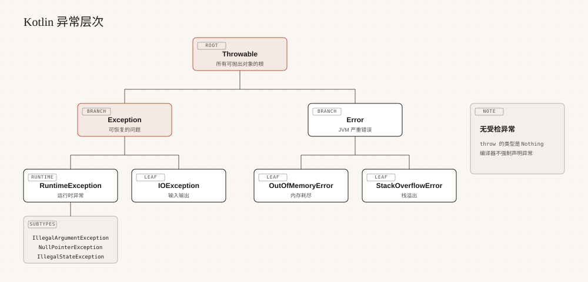

# Kotlin 异常处理

> 来源: https://www.runoob.com/kotlin/kotlin-exception.html

异常是程序运行过程中出现的意外情况，Kotlin 用 try-catch 捕获它们，让程序在出错后仍能继续执行。

与 Java 相比，Kotlin 最大的不同是没有受检异常，编译器不再强迫你为每个方法声明它可能抛出的异常。

本章节从异常层次讲到资源自动关闭，覆盖日常开发中会用到的全部异常处理手段。

---

## 异常层次

Kotlin 的异常体系与 JVM 一致，根类型是 `Throwable`，下面分成 Error 和 Exception 两支。

| 类型 | 含义 | 典型子类 | 是否应该捕获

| Throwable | 所有可抛出对象的根类型 | Exception、Error | 一般不直接捕获

| Error | JVM 层面的严重错误，程序通常无法恢复 | OutOfMemoryError、StackOverflowError | 不建议捕获

| Exception | 程序逻辑或运行环境导致的问题，可以恢复 | IOException、IllegalArgumentException | 应该处理

| RuntimeException | 运行时才暴露的异常，Kotlin 中没有受检异常，绝大多数异常属于这一支 | NullPointerException、IndexOutOfBoundsException | 按需处理

> **提示：**不要把 Error 也一并捕获。像内存耗尽、栈溢出这类问题，即使捕获了也无从恢复，反而会掩盖真正的故障。

---

## try-catch-finally

try 块放可能出错的代码，catch 块按异常类型依次匹配，finally 块无论是否发生异常都会执行。

catch 的匹配是从上到下的，因此子类型要写在父类型前面。

如果某个异常没有被任何 catch 分支匹配，它会继续向上传播给调用者，最终导致程序终止并打印堆栈。

---

## try 作为表达式

在 Kotlin 中 try 是表达式而不是语句，它可以有返回值，返回值是 try 或 catch 块中最后一个表达式的结果。

这一点让「尝试转换，失败时给默认值」这类逻辑可以写得很紧凑。

> **注意：**不要在 finally 块里写 return。这会让 try 和 catch 中的返回值被丢弃，也会吞掉正在传播的异常，是很容易出错的写法。

---

## throw 与 Nothing

用 `throw` 主动抛出异常，表达式本身永远不会有返回值，因此它的类型是 `Nothing`。

`Nothing` 是 Kotlin 所有类型的子类型，表示「此处不会正常返回」，编译器会据此做控制流分析。

标准库里的 `error()`、`TODO()` 以及 `throw` 表达式，返回类型都是 `Nothing`，它们的作用就是把「不可能继续」这件事告诉编译器。

---

## 自定义异常

当内置异常无法表达业务语义时，可以继承 Exception 定义自己的异常类型。

把出错的上下文作为属性保存下来，捕获时就能拿到更多信息。

命名上建议以 `Exception` 结尾，并保留一个接收 `message` 和 `cause` 的构造器，方便异常链向上传递。

---

## Kotlin 没有受检异常

Java 把异常分为受检异常和非受检异常，受检异常必须显式 try-catch 或在方法签名上声明 throws。

Kotlin 取消了这个区分，所有异常都是非受检的，编译器不会强制你处理它们。

| 对比项 | Java | Kotlin

| 异常分类 | 受检异常 + 非受检异常 | 只有非受检异常

| 方法声明 | 受检异常必须写 throws | 不需要声明

| 调用方义务 | 编译器强制处理受检异常 | 编译器不强制，自行决定

| 与 Java 互操作 | 不适用 | 用 `@Throws` 告知 Java 调用方

> **注意：**取消受检异常不等于不用处理异常。Kotlin 把「是否处理」的决定权交回给开发者，代价是漏掉 catch 时只能在运行时才发现问题。

---

## use 与资源自动关闭

文件、流、数据库连接这类资源使用完必须关闭，否则会泄漏句柄。

Kotlin 用扩展函数 `use` 替代 Java 的 try-with-resources，无论块内是否抛出异常，它都会调用 `close()`。

`use` 适用于所有实现了 `Closeable` 或 `AutoCloseable` 的对象，返回值为代码块最后一行表达式的结果，因此也可以这样写：

下面的例子沿用上一段示例生成的 runoob.txt，请先运行上一段代码，或者确保当前目录下已存在这个文件。

---

## runCatching

`runCatching` 把「执行 + 捕获」合并成一个表达式，成功和失败都包装进 `Result` 对象。

适合那些「失败是正常分支」的场景，比如解析用户输入、读取可能不存在的配置。

| 方法 | 作用

| isSuccess / isFailure | 判断结果是成功还是失败

| getOrNull | 成功时返回值，失败时返回 null

| getOrDefault | 失败时返回指定的默认值

| getOrElse | 失败时用异常计算一个兜底值

| getOrThrow | 失败时重新抛出异常

| onSuccess / onFailure | 成功或失败时执行副作用，返回原 Result

`runCatching` 从 Kotlin 1.3 起提供，它返回的 `Result` 类型在 1.5 起稳定。

> **注意：**runCatching 捕获的是 Throwable，会把协程的 CancellationException 也一并吞掉，导致协程无法正常取消。在协程里使用时，要么改用 try-catch 只捕获具体异常，要么在失败分支里把 CancellationException 重新抛出。

---

## 常见问题

下面汇总异常处理中最常见的几个疑问。

| 问题 | 原因 | 建议

| catch 分支不生效 | 父类型写在子类型前面，先被匹配走了 | 把更具体的异常类型写在前面

| 捕获了异常却定位不到问题 | 只打印 message，丢了堆栈 | 用 `e.printStackTrace()` 或日志框架记录完整异常

| finally 里的 return 导致结果异常 | finally 的返回值会覆盖 try 的结果 | finally 只做清理，不要写 return

| 资源没关闭 | 忘了在 finally 里调用 close | 统一改用 use 或 useLines

| 捕获范围过宽 | 直接 catch Throwable 或 Exception | 尽量捕获具体类型，让意外异常正常暴露

### 图片清单

1. 图1 -> images/31-exception-tree.svg （原图：https://www.runoob.com/wp-content/uploads/2026/09/31-exception-tree.svg）
