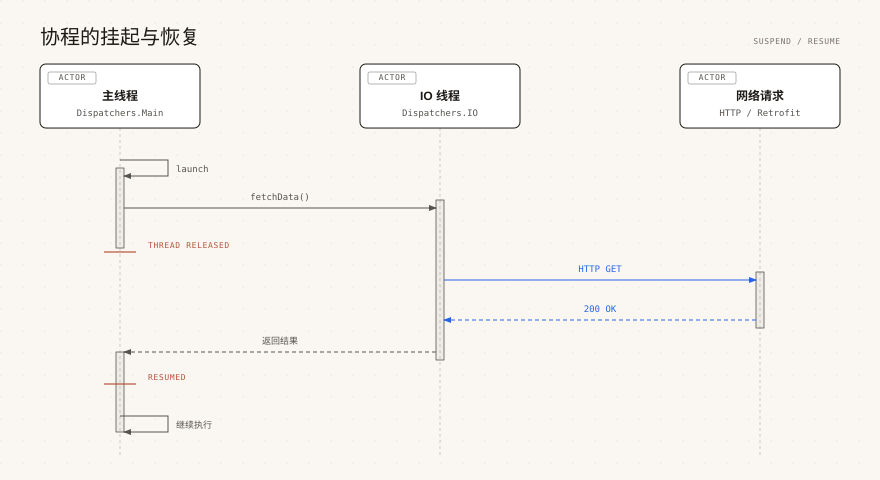

# Kotlin 协程

> 来源: https://www.runoob.com/kotlin/kotlin-coroutines.html

协程是一种可以挂起和恢复的轻量级线程，用来解决异步任务写法复杂、回调嵌套过深的问题。

用协程写出来的异步代码和同步代码结构几乎一样，但执行时不会阻塞线程。

---

## 什么是协程

传统的异步编程依赖回调，几个任务一嵌套就形成了「回调地狱」，错误处理也很分散。

另一种做法是开线程，但线程由操作系统调度，创建成本高，数量一多切换开销就上来了。

协程走的是第三条路：它运行在线程之上，由编译器生成的代码负责挂起和恢复，一个线程可以同时跑成千上万个协程。

关键在于「挂起」不等于「阻塞」：协程遇到耗时操作时会让出线程，线程去执行别的任务，等结果就绪后再把协程恢复回来。

所以协程特别适合网络请求、文件读写、数据库访问这类等待时间远大于计算时间的场景。

协程在 Kotlin 1.3 起成为稳定特性，API 由官方库 `kotlinx-coroutines` 提供。

---

## 第一个协程

最常用的两个构建器是 `runBlocking` 和 `launch`。

`runBlocking` 会阻塞当前线程直到内部所有协程结束，通常只在 `main` 函数和测试里使用。

`launch` 启动一个不阻塞当前线程的协程，返回一个 `Job` 对象。

实例执行输出结果为：

可以看到 `main 协程继续执行` 先打印出来，说明 `launch` 没有阻塞。

B 只等 50 毫秒，A 等 100 毫秒，所以 B 先完成。

> **提示：**`runBlocking` 会真的阻塞线程，写在服务端业务代码里会拖慢整个线程池，所以它只适合作为入口或测试的「桥」。业务代码里应该用 `launch`、`async` 或 `coroutineScope`。

---

## suspend 函数

`suspend` 关键字标记一个可以挂起的函数，它只能在协程或另一个 suspend 函数里调用。

编译器会给 suspend 函数加上一个额外的参数用来传递续体，所以它能记住挂起时的位置。

实例执行输出结果为：

如果把 `fetchSite()` 直接写到普通函数里，编译器会报错，提示只能在协程中调用。

这也是为什么很多框架的接口都声明成 suspend 函数，让调用方自动进入协程上下文。

---

## 结构化并发与 coroutineScope

结构化并发是指父协程会等待所有子协程结束后才结束，子协程失败也会影响父协程。

这样做的好处是不会出现「协程泄漏」：谁启动的协程，谁就负责等它结束。

`coroutineScope` 会创建一个子作用域，挂起直到内部所有子协程都完成。

实例执行输出结果为：

如果希望某个子协程失败时不影响兄弟协程，可以用 `supervisorScope`。

| 构建器 | 返回值 | 异常行为 | 典型场景

| `runBlocking` | lambda 的返回值 | 异常向外抛出 | main 函数、测试入口

| `launch` | Job | 异常向上传播，取消父协程 | 不需要结果的并行任务

| `async` | Deferred<T> | 异常延迟到 await 时抛出 | 需要结果的并行任务

| `coroutineScope` | lambda 的返回值 | 任一子协程失败则整体失败 | 挂起函数内部分并发

| `supervisorScope` | lambda 的返回值 | 子协程失败互不影响 | 一个失败不影响其他

---

## 调度器 Dispatchers

调度器决定协程在哪个线程或线程池上执行，用 `withContext` 可以临时切换。

常用调度器有四种，选择依据是任务类型：CPU 密集还是阻塞式 IO。

| 调度器 | 线程池 | 适用场景

| `Dispatchers.Default` | CPU 核心数（至少 2） | 排序、解析、加解密等 CPU 密集任务

| `Dispatchers.IO` | 按需扩容，默认上限 64 | 文件读写、网络请求、数据库访问

| `Dispatchers.Main` | 主线程 | Android 更新 UI、桌面 Swing/JavaFX

| `Dispatchers.Unconfined` | 不限定，恢复时用调用方线程 | 极少使用，一般只在测试里出现

实例执行输出结果为：

> **提示：**`Dispatchers.Main` 需要额外的平台依赖。Android 上是 `kotlinx-coroutines-android`，桌面 Swing 是 `kotlinx-coroutines-swing`，否则运行时会抛出「Module with the Main dispatcher had failed to initialize」。

---

## 取消与超时

协程的取消是协作式的：调用 `cancel()` 只是发出取消请求，协程要在挂起点才会真正退出。

`kotlinx.coroutines` 里的 `delay`、`yield` 等挂起函数都会检查取消状态。

实例执行输出结果为：

`withTimeout` 在超时时抛出 `TimeoutCancellationException`，而 `withTimeoutOrNull` 返回 `null`。

如果协程正在做纯计算，没有挂起点，取消不会生效，这时要主动调用 `ensureActive()` 或检查 `isActive`。

实例执行输出结果为：

---

## async 与 await 并发

`launch` 不返回结果，需要并发求值时用 `async`，它返回 `Deferred<T>`。

调用 `await()` 会挂起直到结果就绪，两个 `async` 之间是真正并行的。

实例执行输出结果为：

> **注意：**`async` 只有在协程作用域内才有意义。如果写成 `coroutineScope { async { ... } }` 之外的全局作用域，会失去结构化并发，异常也没人处理。

---

## Flow 简介

Flow 是协程版的流，用来处理「按顺序产生多个值」的异步数据流。

它和序列很像，都是惰性的，区别是 Flow 的每个环节都可以是 suspend 函数。

Flow 从 kotlinx.coroutines 1.4 起稳定，构建器是 `flow { }`，用 `emit` 发射元素。

实例执行输出结果为：

Flow 还有几个常用能力：`flowOn` 改变上游的调度器，`catch` 捕获上游异常，`onEach` 在每次发射时做副作用。

实例执行输出结果为：

---

## 异常处理

协程里的异常处理和普通代码类似，可以直接用 `try/catch` 包住 suspend 调用。

`coroutineScope` 会把子协程的异常向上抛，交给外层的 `catch` 处理。

实例执行输出结果为：

根协程（`launch` 直接启动且没有被 catch）的异常可以用 `CoroutineExceptionHandler` 统一处理。

实例执行输出结果为：

> **注意：**不要吞掉 `CancellationException`。捕获 `Exception` 时要先判断是不是取消异常，否则会把正常的取消当成错误处理。

---

## 依赖引入

协程不在 Kotlin 标准库里，需要单独引入 `kotlinx-coroutines-core`。

版本要和 Kotlin 编译器配套，Kotlin 2.2 推荐使用 1.10.x。

用 Maven 时，JVM 平台要选带 `-jvm` 后缀的构件。

---

## 常见问题

下面几个问题在初学协程时出现频率最高。

### Suspend function should be called only from a coroutine

在普通函数里调用了 suspend 函数。把调用方也改成 suspend，或者用 `runBlocking`、`launch` 包一层。

### 为什么 cancel 之后协程还在跑

取消是协作式的，协程没有停在挂起点就不会退出。在循环里加 `ensureActive()` 或 `yield()`。

### runBlocking 和 coroutineScope 有什么区别

`runBlocking` 阻塞线程，用于最外层入口；`coroutineScope` 只挂起协程、不阻塞线程，用于挂起函数内部。

### launch 里的异常为什么没打印

如果异常发生在非根协程里，会被向上传播并取消父协程。要么在内部 try/catch，要么给根协程加 `CoroutineExceptionHandler`。

### Flow 和 Sequence 怎么选

纯计算、同步的场景用 Sequence；涉及挂起操作（网络、IO）的场景用 Flow。

### Dispatchers.IO 会不会线程爆炸

不会。它默认上限是 64 个线程，可以用系统属性 `kotlinx.coroutines.io.parallelism` 调整。

### 图片清单

1. 图1 -> images/34-coroutine-sequence.svg （原图：https://www.runoob.com/wp-content/uploads/2026/09/34-coroutine-sequence.svg）
